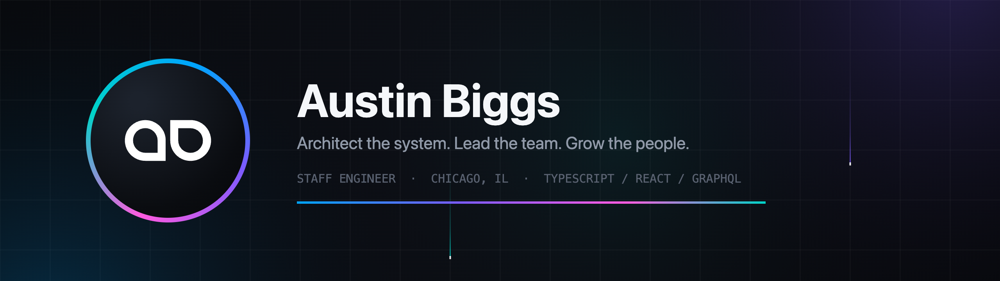

  

### Hi, I'm Austin.

Staff software engineer & technical leader in Chicago. Thirteen years across the full stack — from founding an agency to guiding platform architecture for 160+ engineers. I build systems designed to be used hard, extended by others, and outlast their author.

**[austinbiggs.com](https://austinbiggs.com)** · **[LinkedIn](https://www.linkedin.com/in/austinbiggs/)**

---

#### Currently

- **Building** — image & video infrastructure: data pipelines, geospatial/PostGIS queries, CDN + object-storage architecture
- **Learning** — Zustand + Temporal
- **Growing** — [Cradle](https://cradle.austinbiggs.com), an independent product built end-to-end

#### Signature work

| Project | What it is |
| :--- | :--- |
| **Rosetta** | React component library — 135+ components, 3 themes, the shared visual language of 160+ engineers |
| **Forms Generator** | Schema-driven multi-step forms — describe the flow, get the UI |
| **Search Filtering API** | State-machine-driven headless filtering engine |
| **Candidate Hub** | Employer CRM moving ~20% of all bulk employer messages on the platform |
| **[Stylit](https://github.com/austinbiggs/stylit)** | Dead-simple style primitives for React components |
| **[Cradle](https://cradle.austinbiggs.com)** | Independent product, built end-to-end — live now |

#### Toolkit

`TypeScript` `React` `GraphQL` `Next.js` `Ruby on Rails` `Node.js` `PostgreSQL / PostGIS` `AWS` `Google Cloud` `Nx` `Cloudflare R2` `Supabase` `Jest` `Cypress`

---

  <code>JOURNEY BEFORE DESTINATION</code>

